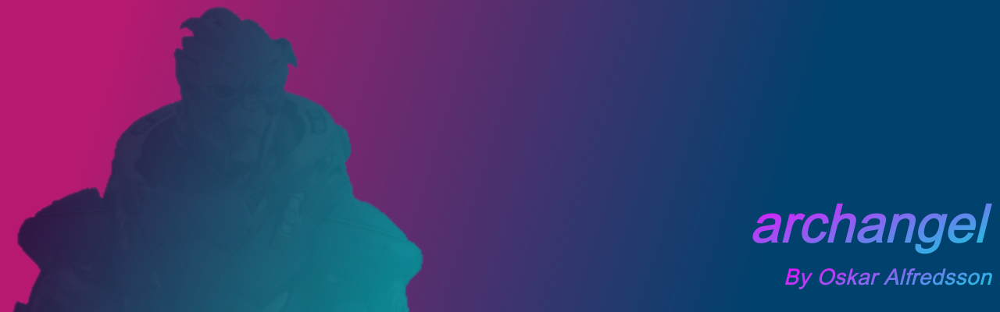

<p align="center">
    
</p>

<br>

<p align="center">
  
  
  
  
  <!-- https://shields.io/badges/ -->
</p>
<br>

## Current Architecture

The firewall API is implemented in C++ under `core/src` with dependencies under `core/lib`. The Flask dashboard lives in `app/web` and reads C++ API data server-side when rendering pages.

## Run

Build and run the C++ API (requires a C++20 compiler and libnftables development files):

```sh
make debug
./archangel --host 127.0.0.1 --port 8080
```

### Run the frontend in Docker

On Linux, with the C++ API running on `127.0.0.1:8080`, start the containerized dashboard:

```sh
docker compose up --build -d
```

The web app writes request, backend, and configuration events to stdout. View them with `docker compose logs -f web`; set `WEB_LOG_LEVEL=DEBUG` before starting Compose for more detail. Request logs omit query strings and form values.

## Project goal

See [docs/goal.md](docs/goal.md) for the project's purpose, long-term architectural direction, and current open questions.

# Development roadmap

See the [development roadmap](docs/roadmap.md) for the current implementation baseline, sequenced work, completion criteria, and longer-term exploratory ideas.

## FaQ
- Is this vibe coded?
No, but it could include AI generated code, but I try to make a effort to note it in the commit message/description. This project is both a passion project for me, and also a way for me to extend my knowledge in C/C++.

- Will this project be completed?
I hope so, I plan on implement this solution for my own servers, but it will take some time to come to a stage where it is usable.

- Can I contribute to this project?
Yes! For the time being, create a feture request under "Issues" so we can discuss it!

- Why Archangel?
It is a refrence to Garrus nickname in Mass Effect 2, the name could change in the future!
