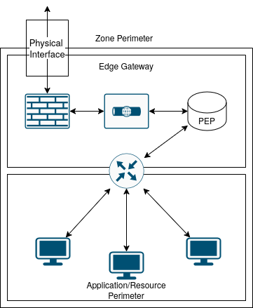
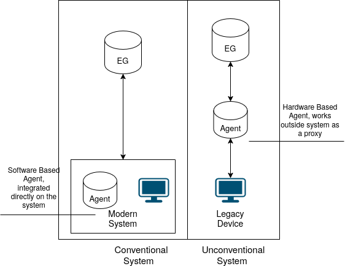
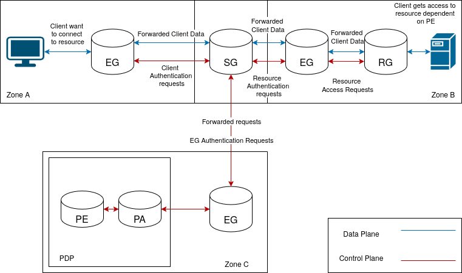
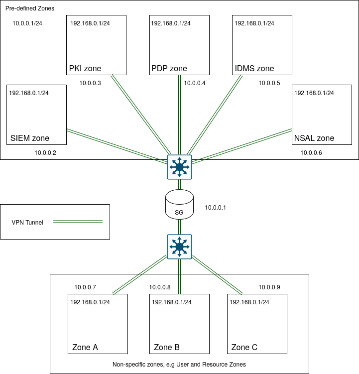
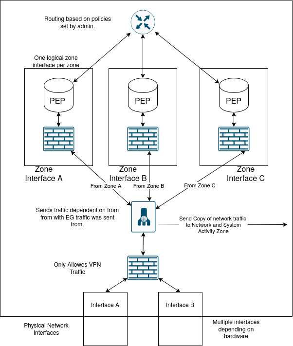

# Project Goal and Direction

## Purpose

Archangel is an open-source firewall project intended to pair a privileged C++ firewall API with a dashboard and, over time, provide a clear and approachable management experience. The API is a backend service that other programs can call; see [endpoints.md](endpoints.md) for the current API and dashboard routes.

The current implementation is an early-stage personal project and is not yet a complete or production-ready firewall-management platform.

## Background and Long-Term Direction

This project continues ideas explored in the author's Swedish thesis, [Zero Trust i isolerade komplexa miljöer](../assets/Zero_Trust_i_Komplexa_Isolerade_Miljöer.pdf). Archangel relates most closely to the thesis's Edge Gateway concept. The broader vision is to help segment networks and control communication between resources through explicit policy.

See the [development roadmap](roadmap.md) for sequenced implementation work and completion criteria. The following diagrams represent conceptual direction, not a description of features that are all implemented today:

### Network zones and endpoints

Clients and servers would use a Resource Gateway (RG) or Device Agent (DA) to establish trusted communication with an Edge Gateway (EG). The RG is envisioned as providing access control for server resources; the DA is envisioned as providing client identity and credentials.

### Segmentation and gateway communication

The long-term concept is to divide resources into network segments and allow only explicitly permitted communication. An Edge Gateway may protect a focused resource or service, while a Segmentation Gateway (SG) provides a logical boundary between Edge Gateways and routes authorized traffic between zones.

The original vision also considers encrypted tunnels between Resource Gateways or Device Agents and Edge Gateways, and between Edge Gateways and the Segmentation Gateway. This could protect otherwise unencrypted traffic and reduce exposure on untrusted network links. The exact protocols, topology, threat model, and feasibility have not yet been decided.

### Thesis-inspired reference architecture

The thesis proposes a Zero Trust architecture organized around separated network zones and a control plane distinct from application/data traffic. The table maps the thesis's conceptual components to the intended project structure. Project status and links distinguish that direction from functionality already implemented:

| Component | Proposed role in the thesis | Project / link |
| --- | --- | --- |
| **Edge Gateway (EG)** | Sits at a zone boundary, controls zone-level communication, and establishes an authenticated, encrypted connection to the SG. | **Archangel** is intended to cover the EG role. See the [project overview](../README.md) and [current API endpoints](endpoints.md). The current implementation is an early firewall API and dashboard, not a complete EG. |
| **Resource Gateway (RG)** | Sits in front of an individual resource and enforces resource-specific access, potentially proxying the resource connection. | **Archangel** is also intended to cover the RG role. See the [project overview](../README.md) and [current API endpoints](endpoints.md). Resource-level identity and policy enforcement are not currently implemented. |
| **Segmentation Gateway (SG)** | Acts as the central network hub that routes and filters inter-zone traffic. | Separate project; **not started**. No project link exists yet. |
| **Device Agent (DA)** | Identifies/authenticates supported endpoints and can provide device-posture information. The thesis also discusses a hardware proxy for legacy endpoints. | Separate project; **not started**. No project link exists yet. |
| **Policy Decision Point (PDP)** | Makes policy decisions using identity, permissions, policy, and context. Its Policy Engine (PE) evaluates requests; its Policy Administrator (PA) conveys decisions to enforcement points. | Could be provided by one or more existing projects. No specific project or integration has been selected; see the open decisions in the [roadmap](roadmap.md). |
| **Policy Enforcement Point (PEP)** | Intercepts access and enforces PDP decisions at a zone or resource boundary. The thesis assigns PEP functions to SG, EG, and RG components. | A role implemented by the applicable gateway project, not a separately selected project. The intended Archangel EG/RG mapping is described above. |
| **Identity management** | Supplies identities, roles, and attributes used to evaluate access decisions. | Existing project/service to be selected; no integration has been chosen. |
| **PKI and certificate services** | Issues, records, and revokes certificates used for mutual authentication and protected gateway links. | Existing project/service to be selected; no integration has been chosen. |
| **Security-event logging and analysis** | Preserves network/system activity and security events for investigation and policy context; the thesis describes protected logs and SIEM analysis. | Existing project/service to be selected; no integration has been chosen. |

The table describes intended project boundaries, not completed integrations. In particular, assigning Archangel the EG and RG goals does not mean the current application already implements their full thesis-defined roles.

In the proposed flow, an endpoint or resource request first reaches an appropriate PEP. The PEP sends an authenticated request over the protected control plane to the PDP. The PDP evaluates identity, permissions, policy, and available security context, then directs the PEPs to allow or deny the communication. Allowed application traffic follows the data plane through the relevant gateways. The proposal includes monitoring active sessions, revoking access when identity or risk changes, logging security-relevant activity, and isolating a zone when needed.

These roles and flows summarize the thesis's proposed design (printed pp. 48–55 and 63–66); they are architectural direction, not implemented Archangel components or a selected deployment plan.

### Security principles and design tradeoffs

The thesis applies three Zero Trust principles to this architecture:

- **Always verify:** authenticate communicating users, devices, services, and gateway peers; the proposal uses mutual TLS and certificate validation for relevant links and sessions.
- **Least privilege:** grant only necessary resource permissions, using RBAC and/or ABAC, and restrict inter-zone communication through microsegmentation.
- **Assume breach:** monitor activity, preserve security logs outside the control of ordinary application zones, and make it possible to isolate an affected zone without unnecessarily disabling others.

The proposal also separates and protects the control plane because manipulating policy decisions could affect the whole environment. It suggests limiting which authenticated PEPs may reach the PDP and separately authenticating and encrypting control-plane communication. These principles need a threat model and implementation design appropriate to Archangel; the thesis's proposed choices are not automatic requirements for every deployment.

The thesis identifies significant tradeoffs: a central PDP or SG can become an availability bottleneck or failure point, and compromise of the PKI can undermine peer and service identities. Fail-closed behavior can protect integrity but reduce availability. Protected logging, monitoring, revocation, recovery, key protection, and availability therefore need to be designed together rather than added as isolated features (printed pp. 73–77).

### Administrative frontend and backend mesh

The intended role of the frontend is to be an administrative tool for configuring and updating backend services. The backend API is also intended to communicate with other backends so that multiple gateways or services can form a mesh, consistent with the wider gateway and segmentation concepts above. The frontend is a management surface, not the authority for backend identity, authentication, or authorization.

This is long-term direction, not current functionality. Peer identity and enrollment, authentication and authorization between backends, secure transport, discovery and membership, topology, configuration propagation, and failure handling all require explicit design. See the [development roadmap](roadmap.md) for sequencing and open decisions.

The thesis suggests a staged proof of concept: first establish secure SG/EG connectivity; next integrate the PDP, PKI, identity management, and required information sources; then add endpoint agents; and finally add RG enforcement for individual resources (printed pp. 75–76). This sequence is a useful planning reference, not a committed implementation order. In particular, it does not replace the project's near-term testing, contribution, and backend security work in the [roadmap](roadmap.md).

## Open Questions and Uncertainties

- The intended comparison with UniFi is about the desired quality of the management experience; exact feature parity, target users, and product scope are not defined.
- The gateway, Resource Gateway, Device Agent, and Segmentation Gateway architecture is a long-term concept. Only the functionality documented in the current source and [endpoints.md](endpoints.md) should be treated as implemented.
- User authentication and authorization, HTTPS, and rate limiting are planned, but their protocols and detailed designs have not been selected. The intended security model requires backend authentication and authorization on every API call; frontend login state alone must not authorize API access. See [SECURITY.md](../SECURITY.md) and the [development roadmap](roadmap.md).
- The intended administrative frontend and backend mesh have no finalized peer trust model, topology, protocols, or deployment design.
- The thesis evaluates a design against Swedish Armed Forces security-function requirements (KSF), but Archangel has not performed a system-specific KSF assessment and must not claim KSF compliance or certification based on the thesis. A concrete deployment and each of its component systems would need its own applicable security analysis.
- The operational design for PDP/SG high availability, behavior during control-plane or PKI failure, certificate/key recovery, protected log retention, monitoring, and safe zone isolation remains open.
- Tunnel/VPN technology, key management, enrollment, routing behavior, and the deployment model remain open design decisions.
- Production readiness, supported platforms and firewall backends, operational requirements, and compatibility goals are not yet established.
